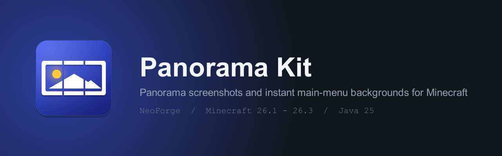
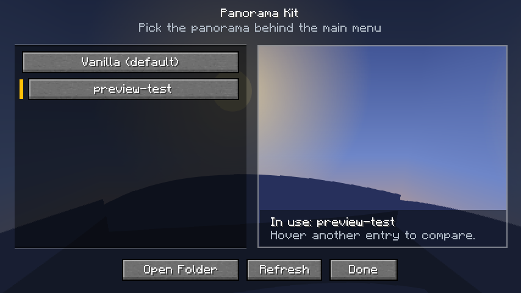
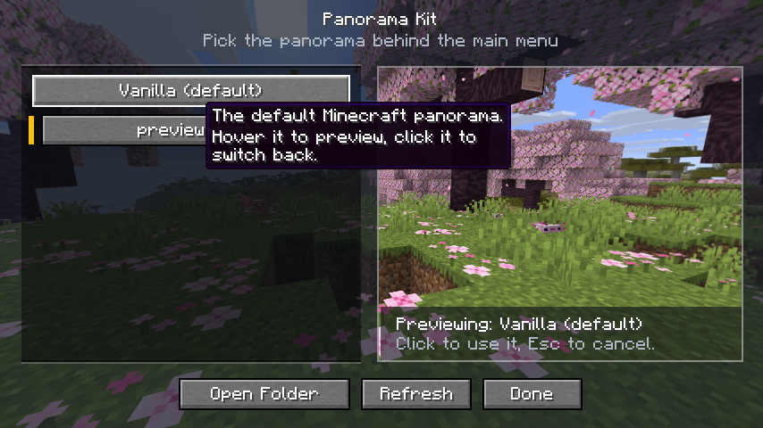
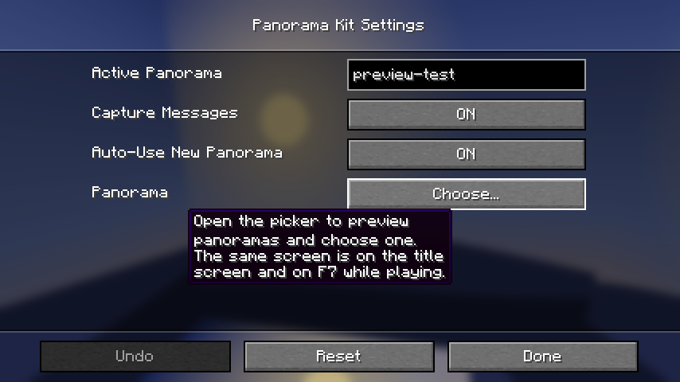

# Panorama Kit



A small client-side NeoForge mod for Minecraft 26.1 - 26.3 by **Jumayusi** that captures
vanilla-style panoramas and lets you switch the main-menu background instantly, with a live preview
of every panorama before you pick it.

## Features

- **F6** captures a panorama using Minecraft's own panorama grabber, so the six cube faces match the
  default title-screen panorama (same FOV, orientation and 1024x1024 face size).
- **Preview before you choose.** The picker draws the real panorama cube map behind itself with a
  dimmed surround and a framed preview pane, so what you see is exactly what the main menu will use.
  Hover (or keyboard-focus) an entry to preview it, click to keep it, or press Esc to go back to the
  current one - previewing never saves anything on its own.
- **Hover text everywhere.** Every button, list entry and config option explains itself on hover, so
  nothing in the mod needs a wiki page.
- **Compact and smooth.** Tight layout that fits small windows and high GUI scales, with a short fade
  when the screen opens and when the preview changes.
- **Instant switching** from the title screen (`Panoramas` button), the **F7** in-game keybind, or
  **Mods -> Panorama Kit -> Config -> Choose...** in NeoForge's mod list.
- **Vanilla** restores the default Minecraft panorama at any time.
- Switching replaces the title-screen panorama texture at runtime. There are no mixins, no resource
  pack reload and no game restart.

## Preview

The picker draws the real panorama cube map behind itself, so the pane on the right is exactly what
the main menu will show. Hover an entry to preview it (its hover text explains what clicking will
do); the selection only changes when you click.

| Previewing a captured panorama | Hovering turns the preview to the default one |
|---|---|
|  |  |

Hover text is on every control, including NeoForge's own config screen:



## Requirements

The mod ships one jar per Minecraft version:

| Minecraft | NeoForge | Java | Side |
|---|---|---|---|
| 26.1 | 26.1.0.19-beta | 25 | Client only |
| 26.2 | 26.2.0.93 | 25 | Client only |
| 26.3 | 26.3.0.99 | 25 | Client only |

## Build

```bash
./gradlew build          # every Minecraft version
./gradlew :mc262:build   # a single one
```

Each target is a Gradle subproject (`mc261`, `mc262`, `mc263`) that compiles the shared sources in
`src/main/java` against its own Minecraft and NeoForge versions:

```
versions/26.1/build/libs/panoramakit-1.2.0+mc26.1.jar
versions/26.2/build/libs/panoramakit-1.2.0+mc26.2.jar
versions/26.3/build/libs/panoramakit-1.2.0+mc26.3.jar
```

The version-specific code lives in `versions/<minecraft_version>/src/main/java` and replaces the
shared file with the same relative path; everything else is shared. Only two files differ between
versions, because Minecraft changed them:

| File | Why it differs |
|---|---|
| `ClientCompat.java` | 26.2 moved the current screen from `Minecraft` to `Gui`; 26.3 replaced GLFW with SDL (`InputConstants.Type.KEYBOARD`) and removed `Util`'s open helpers. |
| `PanoramaTexture.java` | 26.2 replaced `TextureFormat` with `GpuFormat` and uploads images through a staging buffer; 26.3 moved the graphics API to `com.mojang.renderpearl.api`. |

## Install

1. Install the NeoForge version from the table above for your Minecraft version, with Java 25.
2. Put the matching `panoramakit-1.2.0+mc<version>.jar` into the `mods` folder.
3. Start the game.

## Usage

- **Capture:** while in a world, press **F6**. The six faces are written to
  `screenshots/panoramas/<timestamp>/panorama_0.png` ... `panorama_5.png`. The file names and face
  order match the vanilla panorama resources. Both keybinds can be changed under
  **Options -> Controls -> Key Binds** in the **Panorama Kit** category.
- **Preview and switch:** click **Panoramas** in the bottom-left of the title screen, or press
  **F7** in game. The list is on the left, the preview pane on the right; hover an entry to see it,
  click it to keep it. **Refresh** re-scans the folder and **Open Folder** opens
  `screenshots/panoramas` in your file browser.
- **Config file:** `config/panoramakit-client.toml`.

### Configuration

| Option | Default | Description |
|---|---|---|
| `selectedPanorama` | `"vanilla"` | Folder name under `screenshots/panoramas`, or `"vanilla"` for the default. |
| `notifyOnCapture` | `true` | Show chat messages while capturing. |
| `autoSelectCaptured` | `true` | Use a newly captured panorama behind the main menu automatically. |

Changing `selectedPanorama` in the config file is applied on the next client tick, without a restart.

## How it works

- Capture calls `Minecraft#grabPanoramixScreenshot`, the same code vanilla uses for its debug
  panorama key. It renders the world at 4096x4096 and downscales each face to 1024x1024.
- Vanilla's grabber appends a `screenshots` directory to the folder it is given. Panorama Kit waits
  for the six files to finish writing and moves them up into the panorama folder.
- The title screen's cubemap reads the texture registered at
  `minecraft:textures/gui/title/background/panorama` every frame. Panorama Kit registers a custom
  six-layer texture there, so the background changes on the next frame.
- The picker screen draws that same texture as its own background, which is what the preview pane
  shows. Faces are read off-thread; the newest hover always wins, so a preview never flicks back to
  an older one.

## Icon

`docs/icon-1024.png`, the 256x256 `src/main/resources/panoramakit.png` used as the mod logo and pack
icon, and `docs/banner.png` are generated by `tools/icon/IconGenerator.java`:

```bash
java tools/icon/IconGenerator.java .
```

## Notes and limitations

- Capturing needs a loaded world and player, and briefly resizes the render target (vanilla's own
  panorama path does this), so expect a short freeze while the six faces render.
- "Vanilla" means whatever the active resource pack provides for the title panorama.
- A panorama is identified by its folder name. Renaming the folder requires selecting it again or
  editing `selectedPanorama`.
- On Minecraft 26.1 and 26.2 the preview covers the world while the picker is open, because the
  whole-screen background is the panorama. Press Esc to return to the game.
- To build against another 26.x release, update `minecraft_version`, `minecraft_version_range` and
  `neo_version` in `versions/<version>/gradle.properties`.

## Credits

Made by **Jumayusi**.

- `authors` in the mod metadata, the mod list entry and the license holder are all `Jumayusi`
  (`mod_authors` in `gradle.properties`).
- Config option hover text comes from the `comment(...)` calls in `PanoramaConfig`; the UI hover text
  lives in `src/main/resources/assets/panoramakit/lang/en_us.json`.

## License

MIT. The project is based on the official NeoForge 26.1 ModDevGradle MDK (see
`TEMPLATE_LICENSE.txt`).
